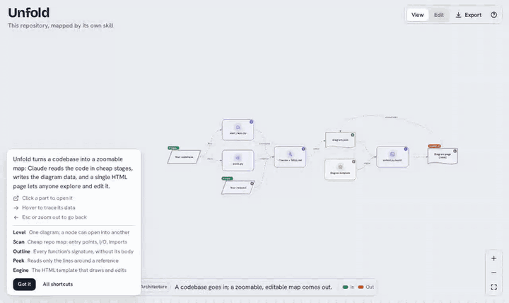
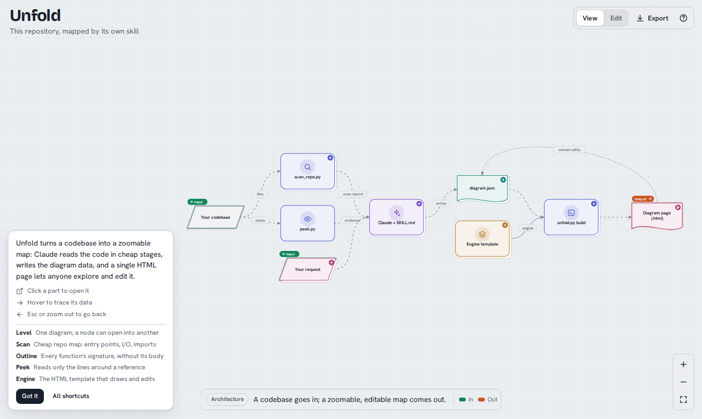
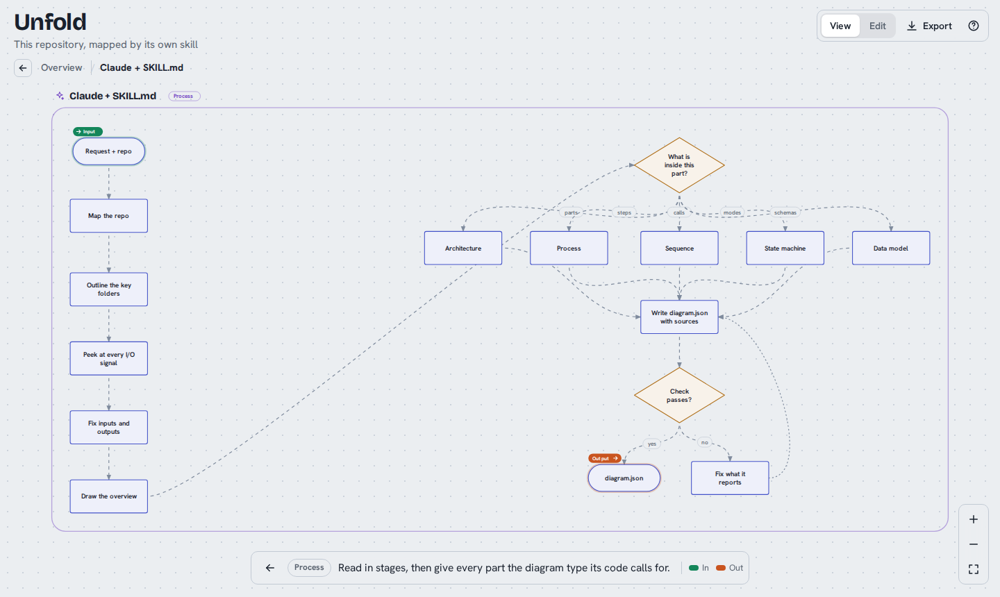
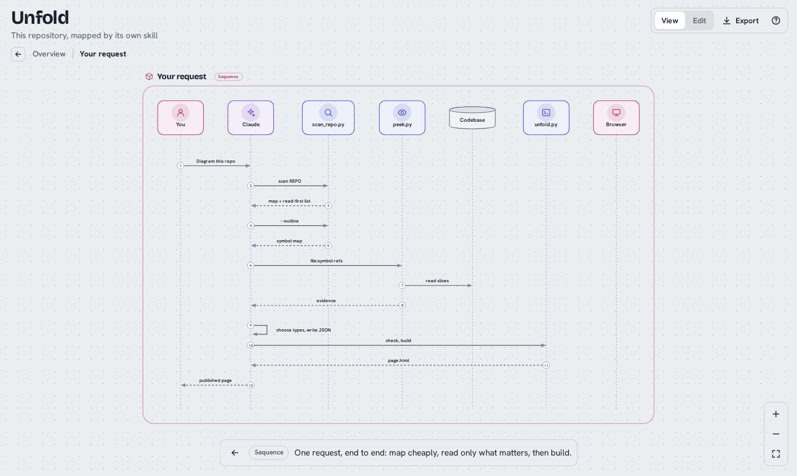
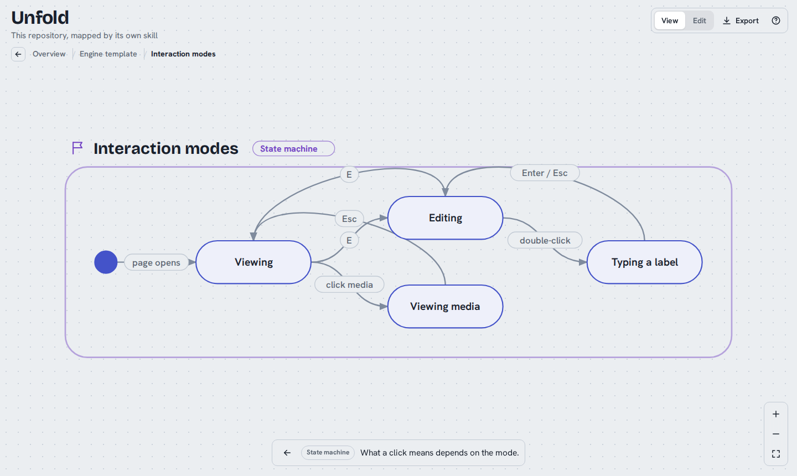
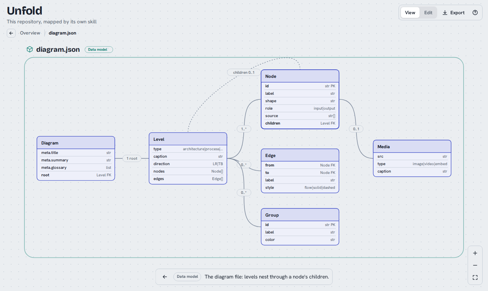
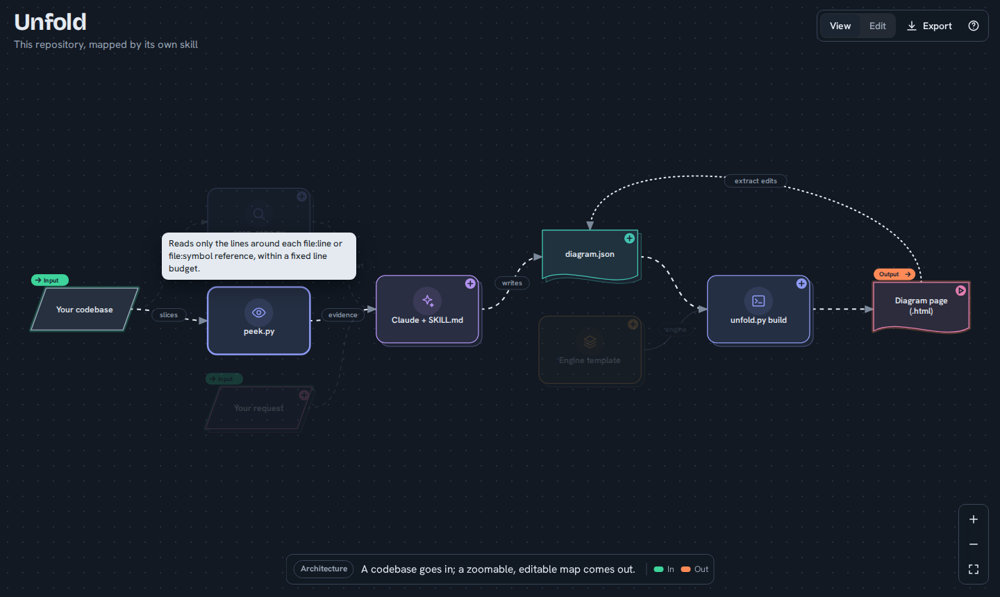
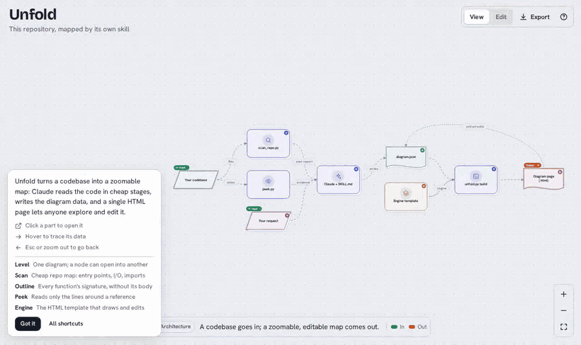

# Unfold

**Zoom into any codebase.** Unfold is a Claude skill that reads a repository and folds it out into an interactive map of what the system does. You start with an architecture overview, with inputs and outputs marked. Click a part and it opens into whatever fits its code: a deeper architecture, a process flowchart, a sequence diagram, a state machine, a data model, or a screenshot or video. Hover anything to trace its data and read a one-line hint. Then edit it by hand, like any diagramming tool.



## Why

Architecture diagrams are usually too flat to teach anything or too dense to read. They also go stale, because nobody can tell which box is which file. Unfold keeps every level small, puts depth one click away, and ties every box to the source it came from. At each level it answers *what comes in, what happens to it, what comes out*, so someone who has never seen the project ends up able to explain it like its developer.

## One map, five kinds of diagram

| | |
|---|---|
|  **Architecture.** Parts, stores and external systems, and how data moves between them. Every overview starts here. |  **Process.** What one part does, step by step: steps, decisions, loops. |
|  **Sequence.** Who calls whom, in time order: a request lifecycle, an action goal, a handshake. |  **State machine.** Modes and the events that move between them. |
|  **Data model.** Entities, fields and keys, with relations by cardinality. |  **Media and tracing.** Screenshots and videos open in a viewer. Hover traces data upstream and downstream, with a one-line hint. |

## How Claude reads the code

Good maps need real understanding, and big repos don't fit in context. So the skill reads in stages, each one cheaper than reading files whole:

| Stage | Tool | What it gives |
|---|---|---|
| Map | `scan_repo.py REPO` | Languages, layout, manifests (npm, Python, Cargo, Go, CMake, ROS 2, Docker, compose, Make), entry points, imports between parts, and I/O signals with `file:line`: HTTP routes, ROS 2 topics/services/actions with message types, queues, CLI args, env vars, files, databases, network, hardware. Ends with a *read these first* list. |
| Shape | `scan_repo.py REPO --outline` | Every class and function with its signature and first docstring line. No bodies. |
| Evidence | `peek.py REPO file:symbol file:line …` | Only the lines that matter, with merged windows and a fixed line budget. |
| Depth | full files | Only the few files that carry the core logic. |

Every node keeps a verbatim `source` reference, and the skill tells you which parts it inferred rather than read.

## The editor



- **Shapes.** A 16-shape palette: component, step, start/end, decision, data, database, document, preparation, cloud, entity table, image, circle, initial and final state, triangle, text. Drag them onto the canvas, or drop image and video files straight on it.
- **Floating toolbar** for the selection: shape, colour, icon, In/Out role, text size, bold, italic, nest, details (note, source, fields, media upload), duplicate, delete. Edges get style, arrows, label, reverse, and message order in sequences.
- **Nest** collapses a selection into a module with its boundary edges rewired; **Expand** reverses it. **Group** draws a labelled region; **Tidy** re-runs auto-layout. Each level's diagram type can be switched from the level bar.
- **Fast building.** Double-click to type. Drag a port to link, or drop it on empty canvas to create a connected node. Tab chains the next step. Marquee select, copy/paste, arrow nudging, undo/redo.
- **Your edits are kept.** They survive a reload. **Export** downloads the page or its data, and a published claude.ai artifact can **Save** into itself.

## Getting around

Open a part by clicking it. To go back, use any of: **Esc**, the **←** button by the breadcrumb, **zooming out** past the level, the browser's **Back**, the mouse back button, **Backspace**, or a double-click on empty canvas. The **?** button shows the map's one-sentence summary, a short glossary of project terms, and the shortcuts. New visitors see it once on their first visit.

## Install

Download `unfold.zip` from the [latest release](../../releases/latest), or run `make package`.

| Where | How |
|---|---|
| **claude.ai / Claude Desktop** | Open Settings, find the Skills section and upload `unfold.zip`. Custom skills need a plan with code execution enabled. |
| **Claude Code** | `cp -r skill/unfold ~/.claude/skills/` for all projects, or into `.claude/skills/` for one project. |
| **Claude API** | Upload the zip through the Skills API (`/v1/skills`) and reference it in your request's container. |

Then just ask:

> Map this repo for our onboarding session. The worker is the tricky bit.

> How does our ROS 2 pick-and-place stack work? Show the data from the camera topic to the arm commands.

> Walk me through this project like I'm going to maintain it.

## The data

A page is the engine plus one JSON document; the full schema is in [`skill/unfold/references/schema.md`](skill/unfold/references/schema.md). The scripts use only the Python 3.8+ standard library and work without Claude:

```bash
python skill/unfold/scripts/scan_repo.py REPO [--outline PREFIX] [--json]
python skill/unfold/scripts/peek.py      REPO path/file.py:symbol path/other.ts:40-80
python skill/unfold/scripts/unfold.py    check   diagram.json
python skill/unfold/scripts/unfold.py    outline diagram.json
python skill/unfold/scripts/unfold.py    build   diagram.json page.html    # inlines local media
python skill/unfold/scripts/unfold.py    extract page.html diagram.json    # continue from browser edits
```

Pages from earlier versions still open.

## Develop

```bash
pip install -r requirements-dev.txt
python -m playwright install chromium

make test       # unit tests: validator, scanner, outline, peek, build, packaging, docs/engine consistency
make e2e        # drives the example in headless Chromium: every level type, navigation, media, the editor
make engine     # rebuild skill/unfold/assets/template.html from engine/
make examples   # rebuild examples
make package    # dist/unfold.zip and .skill
make media      # regenerate README screenshots and GIFs (needs ffmpeg)
```

CI runs the tests on every push. A `v*` tag publishes a release with the packaged skill, and the examples deploy to GitHub Pages once Pages is set to "GitHub Actions". Behaviour tests for the skill itself, including a fixture repo to map, are in `skill/unfold/evals/`.

```
skill/unfold/                the skill (this folder is what gets packaged)
  SKILL.md                   the workflow Claude follows
  assets/template.html       the engine, built from engine/
  scripts/scan_repo.py       repo map, symbol outline, read-first ranking
  scripts/peek.py            budgeted reading of code slices
  scripts/unfold.py          check / build / extract / outline
  references/                schema, and how to turn code into levels
  evals/                     behaviour test cases (not packaged)
engine/                      engine sources: CSS, JS, icons, sample data
examples/                    diagram.json + built index.html
tests/                       unit and end-to-end tests
tools/                       packaging and media capture
```

See [CONTRIBUTING.md](CONTRIBUTING.md) before changing the engine.

## Limitations

- The scanner is regex-based. It misses dynamic wiring (dependency injection, topics built from strings) and reports some false positives. The skill confirms with `peek`, but still review what it marks as inferred.
- Edges connect nodes within one level. A link that crosses levels is shown through the parent's input and output nodes.
- Edges are curves that don't route around nodes. Tidy, or drag, when a dense level crowds.
- Published claude.ai pages block remote images and may block video embeds. Local media is inlined at build time, so prefer that. Standalone files have no such limits.
- Saving into the page needs a host that allows it (a published claude.ai artifact). Elsewhere, use Export.

## License

[MIT](LICENSE)
